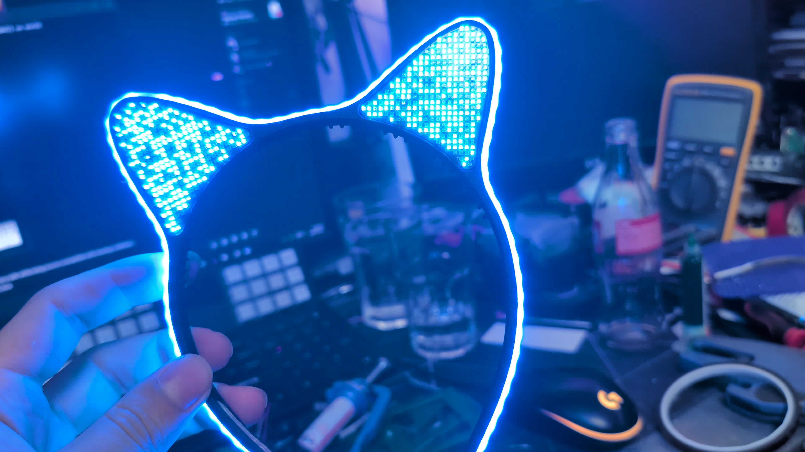

# Catears

High-tech, RGB LED-matrix cat ears, built for fun.

Each ear and each side of the headband carries a small 2D matrix of tiny XL-1010 WS2812B LEDs, driven by an ESP32-S3 running [WLED](https://kno.wled.ge/) with sound-reactive animations, all powered over a single USB-C cable.

## Revisions

| Version | Description |
|---------|-------------|
| V1 / V2 | The original 3D-printed ears and the single-color "Light-Up" variant from the C3CAT assembly (not mine, just the inspiration). |
| V3 | Full-band 5mm addressable COB RGB strip, custom 3D-printed frame, TinyPICO ESP32 and battery in a bulky box. |
| V4.1 | Ear-shaped LED matrix test board to validate the LEDs, power and WLED. |
| V4.2 | ESP32-S3 on the PCB, USB-PD and a buck converter per panel. Over-engineered: it overheated and WiFi was poor (2-layer, then 4-layer respin, then a bypassed DC-DC for 39C3). |
| V4.3 | Current version. Plain 5V in, MPM3805 for 3.3V, tuned WiFi antenna, grid-aligned LEDs, SLS-printed PA12 frame, silicone-mounted PCBs. |

## Repository layout

- `cad/`: 3D models of the headband and ears
- `electronics/`: KiCad projects for each PCB revision
- `wled/`: WLED config, presets and the 2D LED map (generated from the KiCad netlist by `gen_ledmap.py`)

## Read more

The full story, with the mistakes, photos and lessons learned, is in the article:
**[Building high-tech catears for fun and definitively not profit](https://blog.thestaticturtle.fr/building-high-tech-catears-for-fun-and-definitely-not-profit)**

## License

See [LICENSE.md](LICENSE.md).
